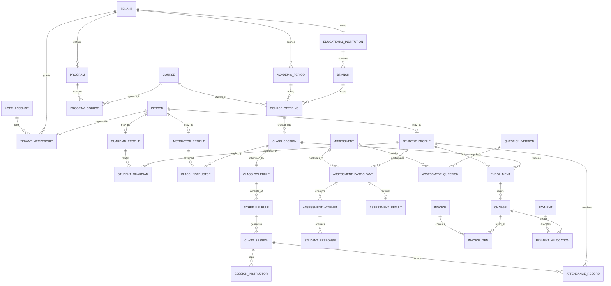

# مدل داده سطح بالا

این مدل برای تعیین مالکیت و ارتباط‌هاست و جایگزین طراحی Migrationهای هر ماژول نیست.

## نمای کلی



## Aggregateهای پیشنهادی

| Aggregate Root | موجودیت‌های داخلی مهم | Invariant اصلی |
|---|---|---|
| Tenant | Institution، تنظیمات | مرز مالکیت تغییر نمی‌کند |
| UserAccount | Credential، Session، ExternalIdentity | شناسه ورود و Provider یکتا است |
| Person | Profileها، شناسه‌ها | داده شخص داخل Tenant یکتا و خصوصی است |
| Program | ProgramCourseها | کد Program در Tenant یکتا است |
| CourseOffering | ClassSectionها | بازه و شعبه معتبر هستند |
| Enrollment | StatusHistory | یک عضویت فعال برای دانش‌آموز و کلاس |
| ClassSchedule | ScheduleRuleها | بازه‌ها معتبر و تداخل کنترل‌شده است |
| ClassSession | Instructor، Location، Attendance | جلسه نهایی‌شده خودکار بازنویسی نمی‌شود |
| Question | QuestionVersionها | نسخه منتشرشده تغییرناپذیر است |
| Assessment | Section، Question، Participant، Policy | انتشار Snapshot قابل بازتولید می‌سازد |
| AssessmentAttempt | Responseها، Eventها | محدودیت زمان و تعداد تلاش رعایت می‌شود |
| AssessmentResult | GradeHistory، Publication | نمره منتشرشده فقط با اصلاح ثبت‌شده تغییر می‌کند |
| Invoice | InvoiceItemها | جمع اقلام با مبلغ فاکتور سازگار است |
| Payment | Allocationها | مجموع تخصیص از پرداخت موفق بیشتر نیست |

## وضعیت‌های اصلی

### EnrollmentStatus

```text
PENDING → ACTIVE → COMPLETED
             ├── CANCELLED
             ├── DROPPED
             └── TRANSFERRED
```

### SessionStatus

```text
PLANNED → CONFIRMED → IN_PROGRESS → COMPLETED
   ├── CANCELLED
   └── POSTPONED → RESCHEDULED
```

`RESCHEDULED` باید دارای ارجاع به جلسه جایگزین باشد.

### AssessmentStatus

```text
DRAFT → PUBLISHED → ACTIVE → CLOSED → GRADING → FINALIZED
  └── CANCELLED             └───────────────┘
```

بازگشت از `FINALIZED` فقط از طریق فرایند اصلاح کنترل‌شده ممکن است.

### AttemptStatus

```text
NOT_STARTED → IN_PROGRESS → SUBMITTED
                    ├────→ AUTO_SUBMITTED
                    └────→ EXPIRED
```

### PaymentStatus

```text
CREATED → PENDING → SUCCEEDED
             ├── FAILED
             └── CANCELLED
SUCCEEDED → PARTIALLY_REFUNDED → REFUNDED
```

## قواعد مشترک داده

- شناسه‌ها UUID هستند و شناسه تجاری جداگانه دارند.
- زمان ایجاد و تغییر و عامل تغییر برای داده‌های مهم ثبت می‌شود.
- مبلغ با نوع decimal و Currency ذخیره می‌شود؛ از float استفاده نمی‌شود.
- Instantها در UTC ذخیره و منطقه زمانی Rule جداگانه نگهداری می‌شود.
- تاریخ آموزشی محلی در صورت نیاز کنار Instant ثبت می‌شود.
- حذف عمومی Soft Delete نداریم؛ هر دامنه Archive، Cancel یا تاریخ اثر مناسب خود را تعریف می‌کند.
- داده تاریخی مانند نتیجه منتشرشده، پرداخت موفق و Audit Log حذف فیزیکی نمی‌شود.
- Constraintهای طبیعی مانند کد دانش‌آموز یا شماره فاکتور همراه `tenant_id` تعریف می‌شوند.

## مدل Multi-Tenant

رابطه منطقی تمام Aggregateهای تجاری به شکل زیر است:

```text
tenant_id + entity_id
```

Foreign Keyهای حساس باید تا حد امکان Tenant را نیز در Constraint پوشش دهند تا اتصال تصادفی دو Tenant فقط در لایه برنامه کنترل نشود. طراحی دقیق Composite Constraint هنگام ساخت Migration هر ماژول انجام می‌شود.

## موارد باز مدل

- `Open`: نیاز قطعی به Student Group مستقل از Class Section برای مدارس.
- `Open`: ساختار طبقه‌بندی Program برای پایه، رشته، سطح زبان و مهارت.
- `Open`: سیاست شماره‌گذاری دانش‌آموز، فاکتور و رسید در سطح Tenant یا Branch.
- `Open`: حمایت از ماه شمسی در قواعد تکرار ماهانه؛ تکرار هفتگی بدون این تصمیم قابل اجرا است.
